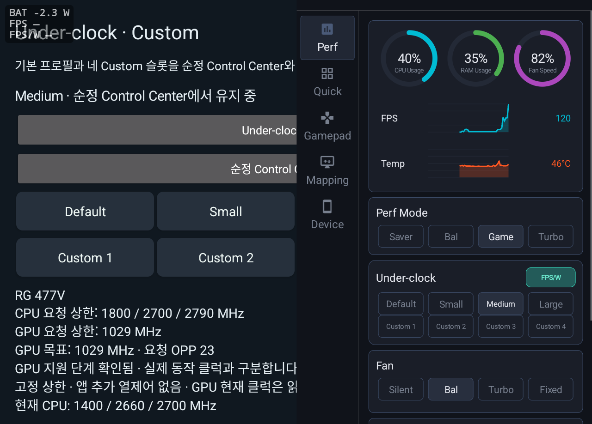
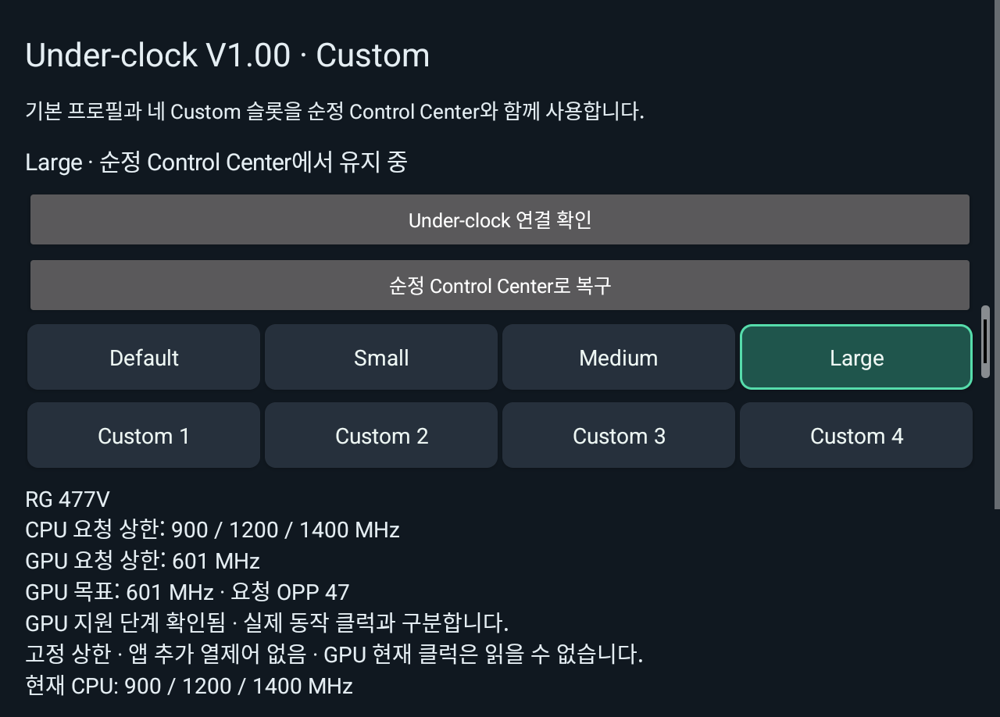

# RG477V Under-clock V1.00 처음 설치하기

**시스템 확인 → APK 설치 → 앱의 Under-clock 설치 버튼 → Control Center 확인** 순서입니다. V1.00은 Shizuku 없이 작동합니다. 루팅·PC·개발자 옵션·USB/무선 디버깅도 사용자 설치에 필요하지 않습니다.

V1.00은 v0.5.1 기반 첫 공개 배포판입니다. 구버전 설치 방식과 혼용하지 마세요. 실기 검증 범위와 미검증 항목은 [알려진 한계](LIMITATIONS.ko.md)에 구분합니다.

## 준비물

**Dimensity 8300 언더클럭을 위해 개발했으며, 실기 구동은 RG477V 8GB에서만 확인했습니다. RG557·RG477M·RG477V 12GB에서는 확인하지 않았습니다.** 같은 칩셋이나 모델 이름만으로 호환을 보장하지 않으며, 아래의 정확한 펌웨어·Control Center 검사는 그대로 적용합니다.

- 검증한 순정 펌웨어를 사용하는 **RG477V 8GB** (다른 용량·모델은 미검증)
- [V1.00 설치 APK](https://github.com/Breeder1229/rg477v-underclock-public/releases/download/V1.00/rg477v-underclock-V1.00.apk)

파일 이름은 **`rg477v-underclock-V1.00.apk`**입니다. 소스 ZIP·검증 JSON·측정 기록은 설치 파일이 아닙니다. 새 사용자는 이 APK 하나만 받으면 됩니다. 파일은 위의 공식 공개 릴리즈에서 받습니다. 릴리즈의 SHA256SUMS.txt로 파일을 확인할 수 있습니다.

## 1단계 시스템 확인

1. RG477V의 **설정 → 기기 정보 또는 휴대전화 정보**에서 순정 시스템 버전을 확인합니다.
2. v1.39로 환경을 맞추려면 [Anbernic 공식 안내](https://win.anbernic.com/cn/xiazaishuju/704.html)의 제조사 절차를 따릅니다.

**v1.39 표시만으로 호환을 보장하지 않습니다.** 앱은 Android14, 내부 빌드 `V654202605290319`, Control Center `1.0.29 / versionCode9`, 정확한 서명·파일·시스템 권한을 확인합니다. 긴 값을 직접 입력할 필요는 없습니다. GammaOS·다른 빌드·다른 Control Center는 지원 대상으로 확인하지 않았으며 검사가 다르면 설치를 중단합니다.

설치된 Control Center가 **1.0.28이라면 먼저 제조사 정식1.0.29 업데이트가 필요합니다.** 이 앱은1.0.28을 입력으로 지원하지 않습니다. 지원 환경을 갖춘 뒤에는 위의 APK 하나로 진행합니다.

## 2단계 이전 앱을 사용했다면

새 사용자라면 이 단계를 건너뜁니다. **v0.5.0 또는 v0.5.1을 사용 중이면 앱을 삭제하지 않고 V1.00 APK로 업데이트**할 수 있습니다. 업데이트 후 앱에서 **Under-clock 연결 확인**을 눌러 새 수정본을 설치합니다. 처음 설치하는 사용자는 **Under-clock 설치**를 누릅니다.

이전 v0.3.0~v0.4.1은 서명·시스템 UID가 달라 **별도 Under-clock 앱을 삭제한 뒤 설치**해야 합니다. 아래 삭제 절차는 이 구버전에만 해당합니다.

1. 별도 **RG477V Under-clock 앱만 삭제**합니다. `.mediumtrial` 등 이전 언더클럭 시험 앱도 제거합니다.
2. **Control Center를 삭제하거나 데이터 전체를 지우지 않습니다.** 기존 Custom 네 슬롯은 Control Center에 남습니다. 기존 수정본을 먼저 순정으로 복구할 필요는 없습니다.
3. Shizuku는 다른 앱이 사용하지 않는다면 삭제해도 됩니다. V1.00에서는 사용하지 않습니다.

별도 앱 삭제만으로 기존 선택이 해제되지는 않습니다. 제한을 해제하려면 먼저 Control Center의 **Default**를 선택합니다.

## 3단계 APK 설치

1. RG477V에서 위의 V1.00 APK를 받습니다.
2. 다운로드 완료 알림이나 파일 앱의 **다운로드** 폴더에서 APK를 엽니다.
3. Android가 출처 허용을 요구하면 해당 브라우저·파일 앱의 **이 출처 허용**을 켜고 설치 화면으로 돌아옵니다.
4. **설치 → 열기**로 **RG477V Under-clock**을 실행합니다.

다른 권한 연결 앱을 설치하거나 페어링 코드를 입력하지 않습니다. 첫 실행 자체는 Control Center를 변경하지 않습니다.

## 4단계 Control Center에 기능 추가

1. 앱에 표시된 **Under-clock 설치**(처음 설치) 또는 **Under-clock 연결 확인**(기존 v0.5.0/v0.5.1 업데이트)을 누릅니다.
2. 포함된 수정본 검사와 설치가 끝날 때까지 기다립니다.
3. **Default · 클럭 제한 없음** 등 정상 상태와 활성화된 프로필 버튼을 확인합니다. 기존 선택이 저장돼 있었다면 그 선택이 표시될 수 있습니다.

이 버튼의 설치는 **Control Center에 Under-clock 메뉴를 추가하는 작업**입니다. 앱에는 수정본과 복구용 순정1.0.29가 포함됩니다. 이 펌웨어와 일치하는 플랫폼 서명·시스템 UID1000·공식 Android 설치 API를 사용하므로 Shizuku를 실행할 필요가 없습니다. 일반 앱보다 권한이 크며 제조사가 제공하거나 보증하는 앱은 아닙니다.

## 5단계 사용 확인

1. 화면 맨 위에서 아래로 내려 **빠른 설정**을 엽니다. 타일이 일부만 보이면 한 번 더 내려 전체를 펼칩니다.
2. **Control Center** 타일 아래가 **사용**으로 표시되는지 확인합니다. 꺼져 있으면 타일을 눌러 **사용**으로 전환합니다. 기본 설정이 켜져 있다고 가정하지 말고 직접 확인하세요.
3. 빠른 설정을 닫고 화면 오른쪽 가장자리를 왼쪽으로 쓸어 **Control Center**를 엽니다.
4. **Perf Mode와 Fan 사이 Under-clock**에서 **Default / Small / Medium / Large**, **Custom 1~4**를 확인합니다.
5. 원하는 프로필을 선택합니다. Custom은 편집 후 **저장 및 적용**을 눌러야 활성화되며 **취소**하면 저장·활성 선택을 변경하지 않습니다.

**FPS/W 표시:** Under-clock 제목 오른쪽, Large 버튼 바로 위의 **FPS/W** 토글을 켜면 좌측 상단에 BAT W·FPS·FPS/W 세 줄이 나타납니다. 초기값은 OFF입니다. BAT의 -는 배터리 방전, +는 실제 순충전이며 외부 전원 연결 중 FPS/W는 —로 표시합니다. [측정값의 뜻과 지원 한계](OSD.ko.md)를 참고하세요.

Default는 이 도구의 클럭 제한 요청을 해제합니다. 다른 프로필은 최대값을 요청하며 실제 클럭을 고정하지 않습니다. 성능 모드와 팬은 독립적으로 선택하고 순정 열 보호는 계속 작동합니다.

재부팅 직후 시스템 준비를 기다리는 경우 저장한 프로필 적용을 최대1분 동안 제한된 횟수로 재시도합니다. 기다리는 동안 Default나 다른 프로필을 선택하면 대기를 취소합니다. 실패해도 저장값은 남으며 안내를 확인하고 다시 선택할 수 있습니다.

## Control Center 화면 참고

기존 v0.5.1 실기 기록의 화면입니다. V1.00의 Control Center 실행부와 화면 구성은 동일합니다. 좌측 별도 앱 제목은 이전 버전의 표시입니다. 상태 표시줄은 공개 자료에서 제외했습니다.

V1.00 업데이트 후 확인한 별도 앱 화면입니다. 기존 Large 선택을 유지한 상태이며 상태 표시줄은 제외했습니다.

## 앱을 닫거나 삭제하면

별도 앱은 수정본 설치와 설정·진단·순정 복구를 제공합니다. 선택값 저장과 요청 갱신은 Control Center가 담당합니다. **앱을 닫거나 강제 종료해도 Control Center의 Under-clock 기능은 계속 사용할 수 있습니다.**

앱 삭제만으로 수정본·메뉴·Custom 값은 제거되지 않습니다. 순정으로 되돌리려면 아래 복구를 먼저 실행합니다. Control Center 자체가 중지되면 마지막 요청은 최대30초 뒤 만료되며 서비스 재시작 때 저장한 선택을 다시 적용합니다.

## 순정 Control Center로 복구

1. Under-clock 앱에서 **순정 Control Center로 복구**를 누릅니다.
2. 확인창을 읽고 **복구**를 누릅니다.
3. 앱이 새 Default 응답으로 요청 해제를 확인하고 검증된 순정1.0.29로 교체합니다.
4. 잔여 요청 만료를 위해 약31초 기다립니다. 완료 안내가 나올 때까지 앱을 열어 둡니다.
5. **순정 Control Center · 자동 재설치 중지** 상태와 Under-clock 메뉴가 사라진 것을 확인합니다.

Custom 값은 남지만 순정에서는 사용되지 않습니다. 팬·Perf Mode 선택과 Control Center의 다른 데이터는 유지합니다. 다른 앱이 만든 클럭 요청까지 해제하는 기능은 아닙니다.

복구 후 앱을 다시 열거나 재부팅해도 수정본을 자동 설치하지 않습니다. 다시 사용하려면 **Under-clock 다시 설치**를 직접 누릅니다. 대기·실패·시간 초과도 자동 재설치를 차단하며 원인 확인 뒤 복구를 다시 시도하거나 재설치를 선택할 수 있습니다.

## 진행이 안 될 때

| 증상 | 확인할 것 |
|---|---|
| APK 설치 실패 | 이전 Under-clock 앱을 삭제했는지, 파일을 정확히 받았는지 확인합니다. Control Center는 삭제하지 않습니다. |
| 펌웨어·서명·시스템 권한·파일 오류 | 시스템 버전과 오류 문구를 기록해 [Issues](https://github.com/Breeder1229/rg477v-underclock-public/issues)에 문의합니다. 검사를 우회하지 않습니다. |
| 첫 실행에 프로필 버튼이 비활성화됨 | 먼저 **Under-clock 설치**를 눌러 정상 응답을 기다립니다. |
| 이전 설치 세션이 끝나지 않았다는 안내 | 잠시 기다린 뒤 다시 시도합니다. 종료를 확인하기 전에는 다음 변경을 하지 않습니다. |
| Control Center가 열리지 않거나 열어 달라는 안내 | 상단 빠른 설정을 펼쳐 **Control Center → 사용**인지 확인한 뒤 오른쪽 가장자리를 쓸어 엽니다. 앱에서 **Under-clock 연결 확인**을 누릅니다. |
| 복구 뒤 프로필 버튼이 비활성화됨 | 순정 상태의 정상 동작입니다. 사용하려면 **Under-clock 다시 설치**를 누릅니다. |

[프로필·측정 결과](../README.md) · [순정 복구](RESTORE.ko.md) · [알려진 한계](LIMITATIONS.ko.md) · [검증 범위](VERIFICATION.ko.md)

작성 기준: 2026년10월17일, V1.00.
